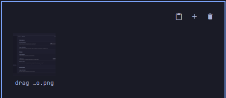

# OmaShelf

A file shelf in the Omarchy bar. Drop or paste files, photos, videos and text onto it, then drag them out into any app.

It works like the BuddyFiles shelf in BuddyMac. The shelf keeps references, so files stay where they are. Removing a file from the shelf never deletes it, with one exception: pasted images and text, and files dropped from a browser, are saved in `~/.local/share/omashelf/items/` and deleted when they leave the shelf.



## Install

```sh
curl -fsSL https://omashelf.buddytools.org/install.sh | bash
```

Run it again to update. Without the script: `omarchy plugin add https://github.com/OxFrancesco/OmaShelf --enable`.

The icon goes in the bar's right section. Move it with `omarchy bar move omashelf --after omarchy.tray`, or drag it along the bar.

Requirements: Omarchy's Quickshell shell, `python3`, `wl-clipboard`, and `ffmpegthumbnailer` for video thumbnails. Add files opens the desktop's file chooser portal through `python-gobject`.

## Use

- Drop files on the icon. Hold them there and the shelf opens, so you can drop into it.
- Paste with Ctrl+V or middle-click the icon. Copied files go in as references. A copied image or text becomes a new file.
- Drag a tile out to drop it into another app. Drag a selection to move several files at once.
- Double-click or Enter opens a file. Ctrl+C copies the selection: a single image goes to the clipboard as image data, anything else as file references.
- Ctrl and Shift click select several files. Ctrl+A selects all, Delete removes the selection, Ctrl+O adds files.
- With more than eight files, press `/` to filter by name.

The `omashelf` IPC target answers `open`, `close`, `toggle`, `paste` and `add <path>`:

```sh
omarchy-shell omashelf add ~/Downloads/report.pdf
```

## Files

- `Panel.qml` is the bar icon and the popup.
- `shelf.py` keeps the shelf in `~/.local/share/omashelf/shelf.json` and handles paste, copy, open and the file chooser. Every command prints the shelf as JSON.
- Video thumbnails are cached in `~/.cache/omashelf/thumbs/`.
- `website/` is the landing page at [omashelf.buddytools.org](https://omashelf.buddytools.org), with the install script. `bun run deploy` from that folder publishes it to Cloudflare.

MIT licensed.
